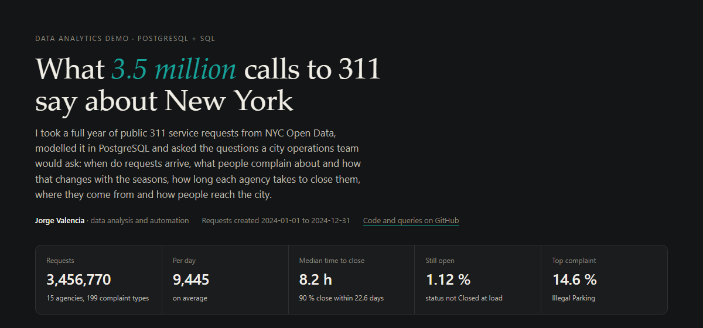
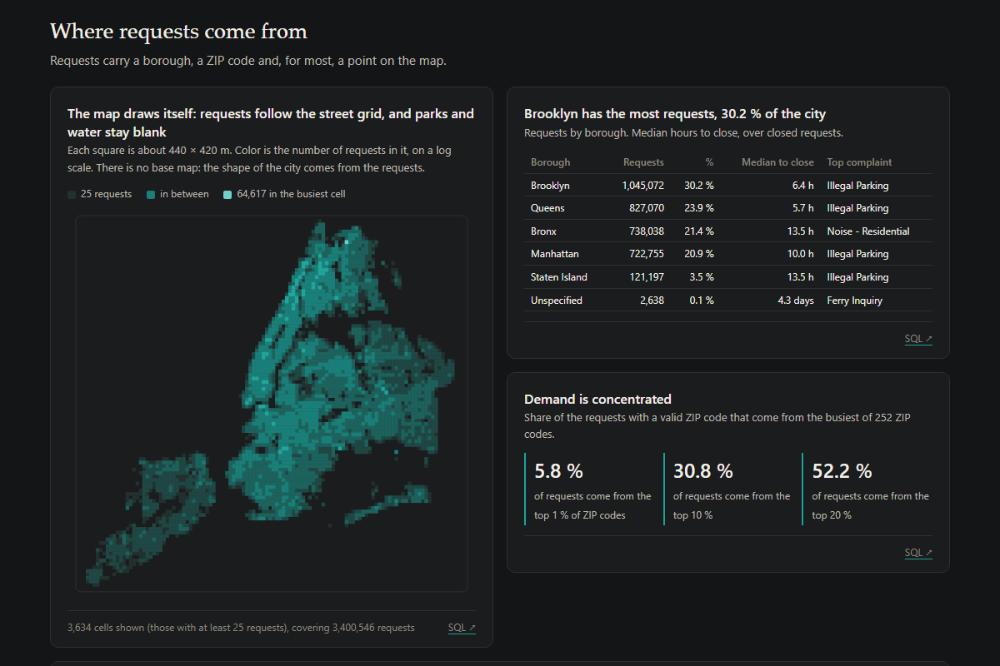
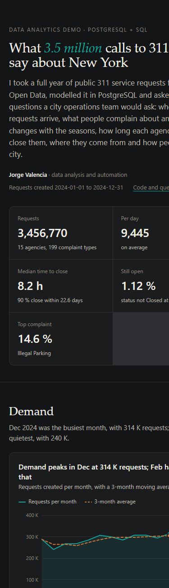
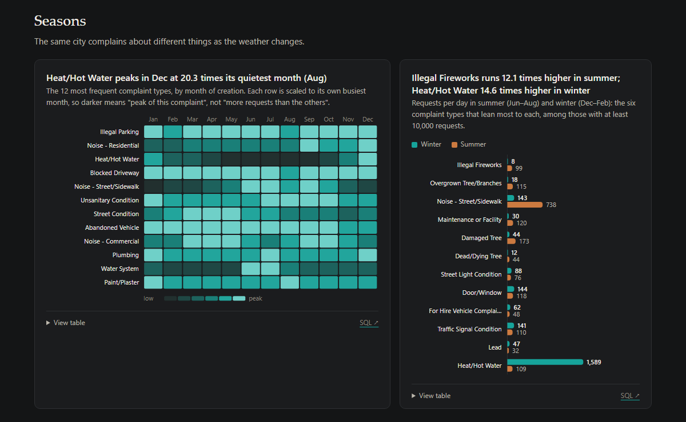
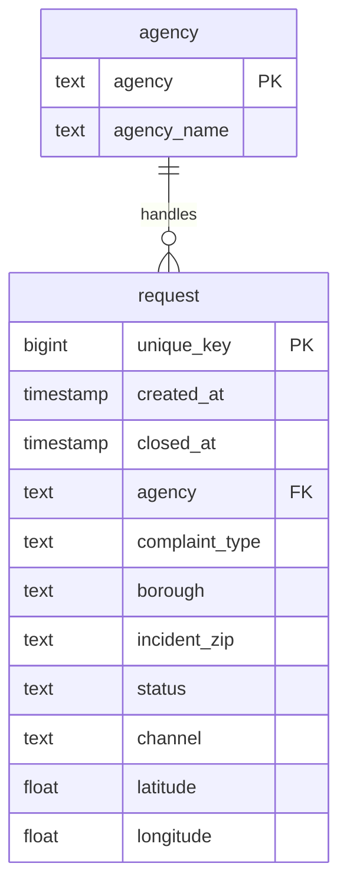
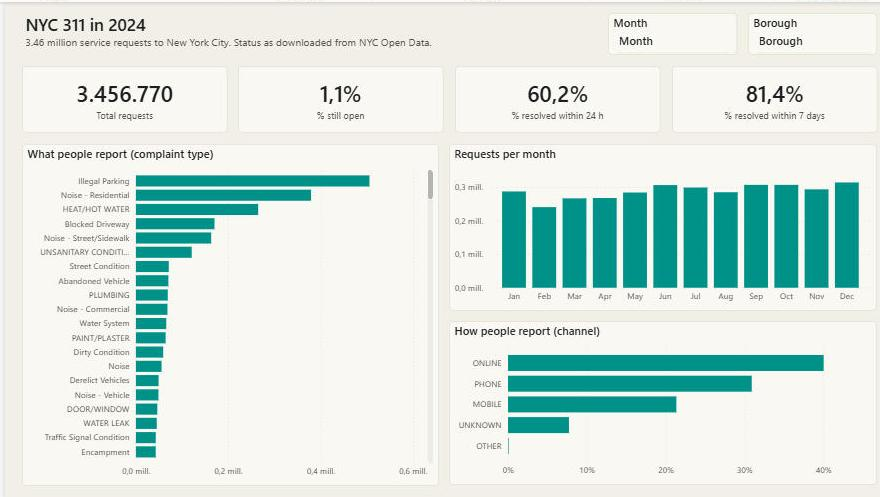
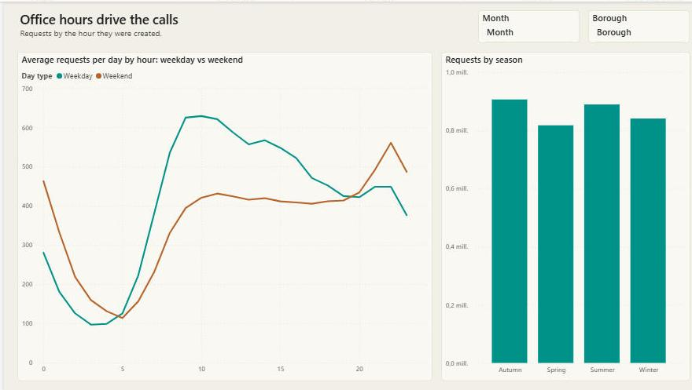
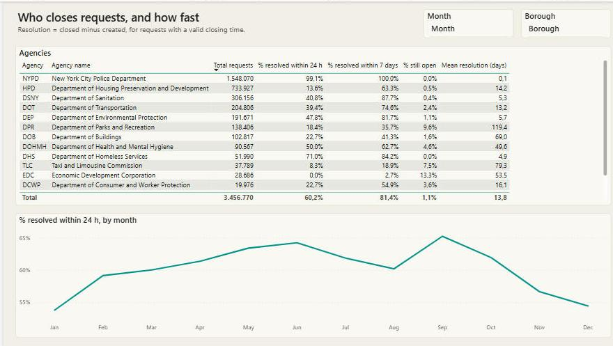
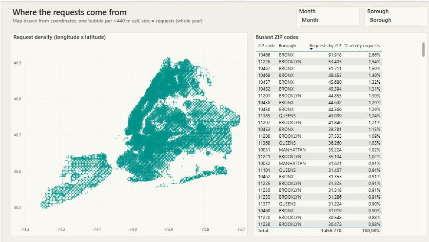

# NYC 311: city service requests analysed with PostgreSQL

I took a full year (2024) of public 311 service requests from NYC Open Data, loaded it into PostgreSQL and asked the questions a city operations team would ask: when do requests arrive, what do people complain about and how does that change with the seasons, how long does each agency take to close them, where do they come from, and how do people reach the city. 3.46 million requests, 15 agencies, 199 complaint types.

**Live dashboard:** https://jorvalfe6-byte.github.io/nyc311-sql-analytics/

The dashboard is a single static page. It reads a 125 KB JSON with already-aggregated results (plus a density grid of 3,634 map cells) and draws every chart, including the map, with no external libraries and no map tiles.





<p align="center"></p>

## What I found

- **Three kinds of complaint are a third of the city's volume.** Illegal parking (14.6 %), residential noise (11.0 %) and heat and hot water (7.7 %) add up to 33 % of all requests. Ten types cover 54 % and 25 types cover 75 %.
- **Almost half of the requests are for the police.** The NYPD receives 44.8 % of all requests and closes them in a median of 1.1 hours. HPD (housing) is next with 21.2 %.
- **Seasons change what the city complains about.** Heat and hot water requests go from 3,105 in August to 62,918 in December, 20 times more. Illegal fireworks run 12 times higher per day in summer than in winter, street noise 5 times. Only one type leans hard to winter: heat and hot water, 14.6 times higher per day.
- **Demand is steady, with a winter dip.** From 240 thousand requests in February (the shortest month) to 314 thousand in December. Monday at 10 am is the busiest hour of the week, with 667 requests on an average Monday; a weekend day brings 89 % of a weekday's volume, and in the quietest hours (3 to 4 am) fewer than 120 requests come in.
- **Closing time depends on who handles it.** The median request closes in 8.2 hours, but 10 % take more than 22.6 days. By agency the median goes from 1.1 hours (NYPD) and one to two days (sanitation, environmental protection, transportation) to 3.9 days (HPD), 16 days (buildings), 26 days (parks) and 72 days (taxi and limousine).
- **The slowest types are not emergencies.** "New Tree Request" has a median of 339 days (21,010 requests), mobile food vendors 187 days, food establishments 134 days. Among the 12 biggest agencies, economic development (13.3 %) and parks (9.6 %) have the highest share still open.
- **The year's median closing time follows the heating season.** 19 hours for requests created in January, 4 hours in June, 18 hours in December. HPD, whose requests are slow, is 35 % of January's volume and 13 % of June's. The median of everything except HPD stays between 2 and 4 hours all year, so much of the swing comes from the mix of complaints.
- **Brooklyn has the most requests, the Bronx has the busiest ZIP codes.** Brooklyn 30.2 %, Queens 23.9 %, Bronx 21.4 %, Manhattan 20.9 %, Staten Island 3.5 %. Eight of the 12 ZIP codes with the most requests are in the Bronx; 10466 alone has 91,919 (2.7 % of the requests with a valid ZIP). I did not compare against population, so this says where requests are, not who complains more.
- **The top 10 % of ZIP codes make 31 % of requests, the top 20 % make 52 %** (252 valid ZIP codes).
- **The map draws the city by itself.** On a grid of 440 m cells, with no base map, the outline of the five boroughs and the rivers between them appear by themselves. 10 % of the cells hold 42 % of the requests.
- **People reach the city mostly online.** Online 40.0 %, phone 30.9 %, mobile app 21.3 %, unknown 7.7 %. Over the year the phone share slides from 33.2 % to 28.3 % and the app grows from 18.3 % to 23.8 %.



## How it is built

```
CSV ──\copy──▶ staging ──transform──▶ core ──▶ mart ──▶ dashboard.json ──▶ docs/index.html
(12 files,      (all TEXT)      (typed, PK/FK/CHECK,   (materialized view,    (aggregates only)
 SODA API)                       one transaction)       flags per request)
                                    │                        │
                                    │                        └──▶ powerbi (star schema views)
                                    └──▶ audit.load_log (rows read vs. rows loaded)
```

| Layer | What it does |
|---|---|
| `staging` | Receives the 12 monthly CSV files as text, untouched. A strange value cannot stop the load. |
| `core` | Typed model with primary keys, foreign keys and `CHECK`s. Keeps every request. The transformation runs in one transaction and can be repeated without duplicating anything. |
| `audit` | One row per table per load: how many rows came in and how many stayed. |
| `mart` | `fact_request`, a materialized view with one row per request, its derived fields and one flag per data problem. All analysis reads from here. |
| `powerbi` | A star schema of plain views (one fact, five dimensions) for Power BI. Created at the end of every load. |
| `powerbi_extract` | The same star schema with the facts pre-aggregated, small enough to ship as CSV with the Power BI report. Created at the end of every load. |

### Data model



## Power BI report

Besides the web dashboard, the repo includes a Power BI report in `powerbi/` with the same analysis, so it can be sliced by month and borough without writing SQL.









| Page | What it answers |
|---|---|
| Overview | Requests, share still open, share resolved within 24 h and 7 days; complaint types, months and channels |
| When | Average requests per day by hour, weekday vs weekend; requests by season |
| Resolution | Each agency's volume, speed and share still open; % resolved within 24 h by month |
| Where | Request density map drawn from coordinates (no map tiles) and the busiest ZIP codes |

**How it is built.** There are two Power BI schemas, for two ways of connecting:

- `powerbi` (`sql/05_powerbi_views.sql`) is a star schema with one row per request, for a live connection to PostgreSQL.
- `powerbi_extract` (`sql/06_powerbi_extract.sql`) pre-aggregates the facts at the finest grain the report needs: requests by month × agency × complaint type × borough × channel, by date × hour × borough, by month × ZIP, and by map cell. Every measure is a sum of those columns, so totals stay exact. The load checks that each aggregated fact adds up to the 3,456,770 requests in `core`.

`scripts/export_powerbi.sh` writes `powerbi_extract` to `powerbi/data/` (2.5 MB, against about 250 MB at one row per request) and the report reads those files, so it opens without PostgreSQL. The project uses the PBIP format: the model in TMDL and the report in PBIR, plain text that diffs like any other file.

I checked the measures against the SQL queries: NYPD handles 44.8 % of requests and HPD 21.2 %; illegal parking is 14.6 %, residential noise 11.0 % and heat/hot water 7.7 %; online is 40.0 % of the channels and phone 30.9 %; ZIP 10466 has 91,919 requests. Medians cannot be rebuilt from aggregated sums, so the report shows the share resolved within 24 hours and 7 days instead; the medians quoted above come from `sql/analysis`.

**To open it** you need Power BI Desktop (free, Windows only). Open `powerbi/NYC311.pbip`. The `DataPath` parameter points to the `powerbi/data/` folder of this repository on GitHub, so a refresh is enough. To read the CSV files from your local copy instead, change `DataPath` in Transform data → Edit parameters to your `powerbi\data\` folder (with the trailing backslash).

## The queries

Every file in `sql/analysis/` runs on its own, and its header says what each result row represents.

| File | Question | Techniques |
|---|---|---|
| `00_data_quality.sql` | Did the load come out complete? | 23 checks: exact for structure, ranges for what the live source can change |
| `01_kpis.sql` | Executive summary | `PERCENTILE_CONT`, `FILTER` |
| `02_monthly_volume.sql` | Monthly demand | Calendar from `generate_series`, `LAG` for month-over-month, moving average, `RANK` |
| `03_weekday_hour.sql` | When do requests arrive? | Normalised per calendar day of each weekday, index against the peak cell |
| `04_top_complaints.sql` | What do people complain about? | Share and running share with window `SUM` |
| `05_seasonality.sql` | How do complaint types shift by season? | Requests per day in each season, conditional aggregates, summer/winter ratio |
| `06_resolution_time.sql` | How long does each agency and type take? | Median and p90, share still open, `HAVING` on volume |
| `07_geography.sql` | Boroughs and ZIP codes | `MODE`, cumulative share, `PERCENT_RANK` concentration |
| `08_density_grid.sql` | Where do requests happen? | Lat/long grid with `FLOOR`, share held by the densest cells |
| `09_channels.sql` | How do people reach 311? | Channel mix overall and by agency |
| `10_data_quality_issues.sql` | What is wrong with the data? | One count per flag, by agency and by status |

## Decisions and problems I found in the data

- **The source is alive.** The dataset is updated every day, and a request created in 2024 can still be closed years later: the latest closing date in my load is from 2026-11-14. The figures in this README and the dashboard are those of the day I loaded it (2026-11-16). If you load it later, closing times and the share still open will move a little, and the checks that depend on them are ranges, not exact values.
- **Every request is in exactly one of four groups.** Open (status is not Closed), Closed with a usable closing time, Closed with no closing date, and Closed with a closing time before the creation time. The status column is the city's own label, and I use it to decide what is open. Only the second group enters the resolution statistics; the other groups stay in every other count and keep their flag.
- **27,563 requests (0.80 %) say Closed but have no closing date.** They cannot give a resolution time. Another 2,988 (0.09 %) are not closed and still have a closing date. 79 requests (66 of them NYPD) were closed before they were created, which cannot be true.
- **Percentiles of slow groups are biased downwards.** A request that is still open has no closing time, so it cannot enter the median. Where many requests are still open (parks 9.6 %, economic development 13.3 %, "Overgrown Tree/Branches" 19.8 %) the real median is higher than the one shown. The dashboard shows the share still open next to every percentile.
- **Seasons are calendar seasons.** Winter is December to February of the same year, so it mixes the start and the end of 2024. I compare requests per day, not totals, because the seasons have different lengths.
- **52,734 requests (1.53 %) have no coordinates, 34,340 (0.99 %) have no ZIP code** and 1,796 (0.05 %) have a ZIP outside the city ranges (10001 to 10499 and 11004 to 11697), a typo or a placeholder. All stay in the volume counts; they only drop out of the ZIP ranking and the map. No coordinate falls outside the city.
- **38,745 requests (1.12 %) look like duplicates:** same second, agency, type, descriptor and coordinates as an earlier request. I flag them and keep them. Two neighbours can report the same noise in the same second, and I have no field to tell a repeat from a real second report.
- **The borough "Unspecified" holds 2,638 requests,** and its most common type is "Ferry Inquiry", which has no place. I kept it as the city labels it.
- **Channel "UNKNOWN" is 7.7 %** of the requests and has the slowest median (72.5 hours). I did not investigate why.
- **Timestamps have no time zone.** They are local to New York City, so I use `TIMESTAMP`, not `TIMESTAMPTZ`.
- **A trap I fell into and fixed.** My first definition of "open" was "no closing date". It counted the 27,563 requests that say Closed but have no date as open, which inflated the share still open. The status column decides it now, and the four groups add up to the total (one of the checks).

## How to run it

You need PostgreSQL 14 or newer (`psql` 13 or newer), Python 3 and about 3 GB of free disk space (800 MB of CSV, 2.2 GB in the database).

```bash
createdb nyc311
export PGDATABASE=nyc311             # plus PGHOST / PGUSER / PGPASSWORD if needed
./scripts/download_data.sh           # 12 files, about 800 MB, about 20 minutes
./scripts/load.sh                    # schema, load, transform, views and checks
./scripts/export_dashboard.sh        # regenerates docs/data/dashboard.json
./scripts/export_powerbi.sh          # regenerates the CSV files in powerbi/data/
```

The download uses the public API of NYC Open Data (no account, no token), in pages of 50,000 rows with a stable order, four months at a time. It compares each month with the row count the API reports and warns if they differ. `SAMPLE=1 ./scripts/download_data.sh` takes only 2,000 requests per month.

The full load takes about six minutes on my machine. At the end it prints the data-quality checks, which must all say `OK`; if any says `REVIEW`, the script exits with an error. On Windows, `scripts/run_all.bat` runs the three steps with Git Bash.

**About CI.** Every push runs the same pipeline in GitHub Actions, but on a fixed sample (the first 2,000 requests of each month, 24,000 rows) with `SAMPLE=1`, because the full year is 3.4 million rows and about 20 minutes of API calls. It runs the checks (with the sample size as the expected value), every analysis query and the dashboard export, and checks the JSON has all its sections. It does not compare the JSON with the published one: the source changes every day, so that comparison would fail for reasons that are not bugs.

The dashboard is served by GitHub Pages straight from `docs/` (Settings → Pages → Deploy from a branch → `main` → `/docs`). To see it locally:

```bash
python3 -m http.server --directory docs
```

## Structure

```
sql/
  01_schema.sql            schemas, tables and constraints
  02_transform.sql         staging → core, audit and indexes
  03_marts.sql             fact_request with the validity rules and flags
  04_dashboard_views.sql   views that feed the dashboard
  05_powerbi_views.sql     star schema for Power BI, one row per request (schema powerbi)
  06_powerbi_extract.sql   aggregated extract the report reads (schema powerbi_extract)
  analysis/                one query file per question (00 = checks, 01–10 = analysis)
scripts/
  download_data.sh         fetches the 12 monthly files from the API
  load.sh                  end-to-end load and checks
  export_dashboard.sh      exports aggregates to JSON
  export_powerbi.sh        exports powerbi_extract to CSV
  run_all.bat              Windows launcher
docs/
  index.html               dashboard (GitHub Pages)
  data/dashboard.json      aggregated results
  img/                     screenshots used in this README
powerbi/
  NYC311.pbip              Power BI project (open with Power BI Desktop)
  NYC311.SemanticModel/    model: tables, relationships and DAX measures (TMDL)
  NYC311.Report/           pages and visuals (PBIR)
  data/                    CSV files the report reads
data/                      raw CSV files (not committed)
```

## License

- **Data:** [311 Service Requests from 2010 to Present](https://data.cityofnewyork.us/Social-Services/311-Service-Requests-from-2010-to-Present/erm2-nwe9), published by the City of New York on NYC Open Data under its [Terms of Use](https://www.nyc.gov/html/data/terms.html). The raw files are not in the repository; `docs/data/` and `powerbi/data/` contain aggregates only, with no address and no description of any request.
- **Code** (SQL, scripts and page): MIT, see [LICENSE](LICENSE).

---

**Jorge Valencia**, data analysis and automation. If you have business data in spreadsheets or in a system that gives you no reports, this is the kind of work I do.
